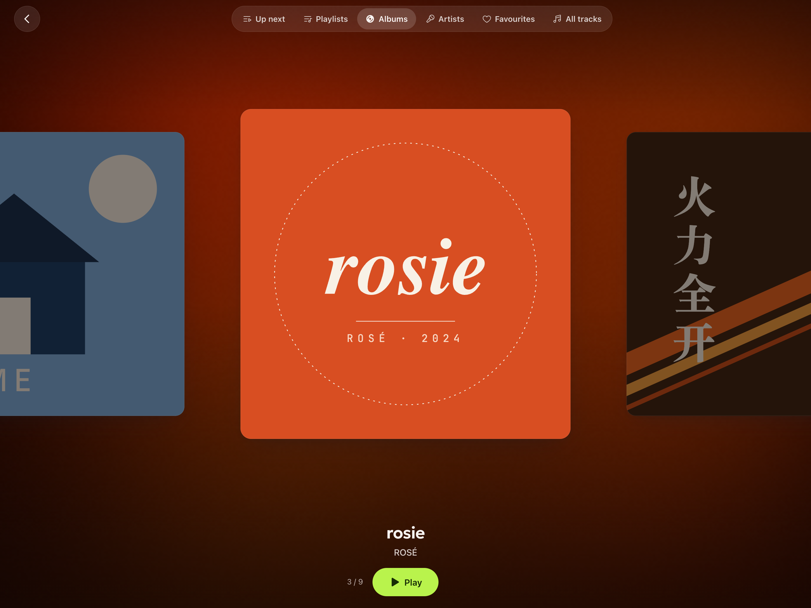
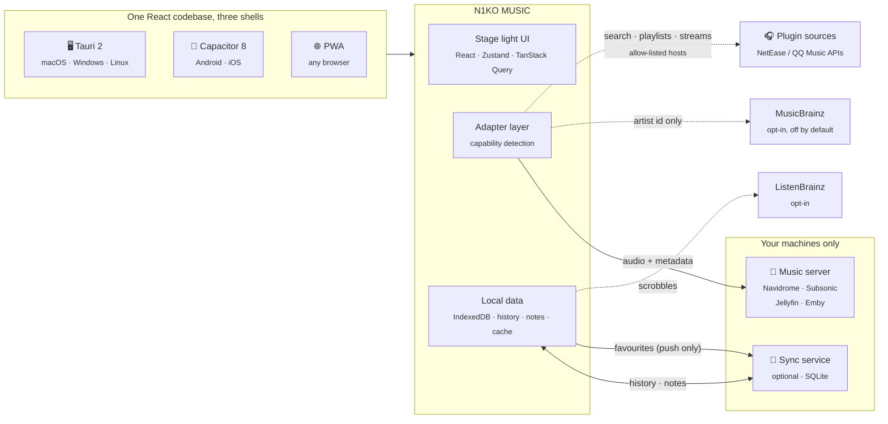

<div align="center">


# N1KO MUSIC

**Your own library, played well**

Point it at Navidrome / Subsonic / Jellyfin / Emby and play the music on your own NAS.
No NAS? Sign in with your own NetEase Cloud Music or QQ Music account (QQ or WeChat QR)
and listen anyway. iPhone, iPhone Duo, iPad and the desktop each get a layout that fits.

[](https://github.com/baogutang/N1KO-MUSIC/releases/latest)
[](https://github.com/baogutang/N1KO-MUSIC/stargazers)
[](LICENSE)
[](https://github.com/baogutang/N1KO-MUSIC/releases/latest)

**[🌐 Website](https://baogutang.github.io/N1KO-MUSIC/)** ·
**[⬇ Download](https://github.com/baogutang/N1KO-MUSIC/releases/latest)** ·
**[中文](README_CN.md)** ·
**[Translate it](TRANSLATING.md)**

<br/>


</div>

<br/>

## From the same author · N1KO-API

[](https://token.baogutang.top)

> If you build with AI, this one is for you: **[N1KO-API](https://token.baogutang.top)** — a
> subscription-to-API relay platform. One key for Claude, GPT and Gemini flagships, smart
> routing with instant failover, 99.9% SLA, transparent pay-as-you-go billing. Support QQ: 783246411.

<br/>

## Stage light

Most music clients are admin panels with album art: tables, filters and counts, organised around what the server holds.
N1KO MUSIC wants to be a player you leave open all day. v6 rebuilt the interface around one idea: **the song that is playing is the light in the room.**

|  | |
|---|---|
| **The room takes the colour of the song** | The shell is a quiet porcelain white (graphite at night), and the cover of the current track washes it in its own colour. Only the hue is taken; lightness is fixed per theme, so text stays just as readable whatever the cover. When the track changes, the new colour spreads outward from the cover. |
| **The lights go down** | The full-screen player is always a dark stage: the background is a light field sampled from the cover, four soft lights drifting slowly; lyrics are set large and the current line is fully lit. Opening it unfolds the stage from the player bar while the cover flies over from the mini player; closing it reverses the trip. |
| **Pick by cover** | Under the controls sit Up Next, Playlists, Albums, Artists, Favourites and All tracks. Each opens a row of large covers: swipe through them and tap the one in the middle to play it. The cover that is playing still flicks: left for the next track, right for the previous one. |
| **It moves like a thing** | Every press answers immediately and settles back without wobble; drags follow the finger, keep their velocity and can be interrupted at any time. Mouse wheels get an inertial glide (trackpads and touch already have one, so they are left alone), shelves snap card by card, and switching light and dark spreads out from the toggle. With Reduce Motion on, movement turns into plain fades. |
| **Window-shaped, not device-shaped** | A narrow window gets a floating tab bar, a medium one a navigation rail, a wide one an iPadOS-style sidebar plus a Now Playing panel. |
| **Nuomi and Maodou** | A white bunny in overalls and a green frog in headphones. They only appear when there is nothing else to look at: the splash, the welcome screen, an empty list, an error, with one pose per state. |
| **Nothing made up** | Every generated sentence in the app (editor's notes, rediscovery reasons, taste weights) is built from real numbers. If the data cannot carry a sentence, the sentence does not appear. |

Headings and large figures use Geologica (self-hosted); the interface uses the system font (SF / PingFang). Sound quality was not traded for any of it:
FLAC / WAV / ALAC play untouched, 320 / 192 / 128 kbps are there when bandwidth is tight, and ReplayGain uses the gain your server already computed.

Free and open source. No account, no tracking, no paid tier.

The design contract (tokens, components, motion rules) is in [`DESIGN.md`](DESIGN.md). Nuomi and Maodou are the author's own characters, © N1KO and not licensed under MIT;
the source renders, the prompts behind them and the local cut-out script are in [`docs/redesign/v6/mascots/`](docs/redesign/v6/mascots/).

<br/>

## Interface

<table>
<tr>
<td width="50%"></td>
<td width="50%"></td>
</tr>
<tr>
<td><b>Now Playing</b>: in a landscape window the cover and controls sit on the left with the ways to browse underneath; lyrics stay on the right, tap any line to jump to it.</td>
<td><b>Pick by cover</b>: Up Next, playlists, albums, artists, favourites and all tracks, each as a row of large covers. Swipe through, tap the one in the middle to play it.</td>
</tr>
<tr>
<td width="50%"></td>
<td width="50%"></td>
</tr>
<tr>
<td><b>Dark</b>: graphite at night, with the room lit by the current cover. Follows the system setting.</td>
<td><b>Album page</b>: tap a card and its cover flies into place; scroll and the header folds away. Tracks, liner notes and your own margin note live on one page.</td>
</tr>
<tr>
<td colspan="2" align="center"></td>
</tr>
<tr>
<td colspan="2" align="center"><b>Connect</b>: self-hosted servers and streaming sources both start here.</td>
</tr>
</table>

<p align="center">
&nbsp;
&nbsp;
&nbsp;

</p>

<sub>Left to right: Home on iPhone (floating tab bar and mini player; swipe the mini player to change tracks), Now Playing on iPhone, a half-folded iPhone Duo (lyrics above the fold, cover and controls below), an album page on iPad in portrait (navigation rail).</sub>

<br/>

## On iPad and iPhone Duo

**iPad.** In landscape the sidebar, the page and the Now Playing panel sit side by side
(the panel opens by default in windows wider than 1180 points). Portrait or half-screen
Split View switches to a side rail; Slide Over gets the iPhone layout. With a Magic Keyboard
or a trackpad attached:

- Hold ⌘ for a second to see every shortcut
- ⌘1 / ⌘2 / ⌘3 Home, For You, Library; ⌘F search; ⌘L full screen lyrics; ⌘[ / ⌘] back and forward
- ⌃⌘S hides or shows the sidebar; ⌥⌘P toggles the Now Playing panel
- Right-click a song for its menu (same as a long press); drag songs with the trackpad into Up Next or a sidebar playlist

**iPhone Duo.** The cover screen gets the iPhone layout; unfolded you get a side rail, after
the way QQ Music handles the Duo. Stand it half folded and Now Playing splits in two: lyrics
above the hinge, the cover strip and controls below. Browsers report the fold through the
Device Posture / Viewport Segments APIs; the native iOS shell cannot see it yet (WebKit does
not expose the posture), so it needs a small native bridge, which is planned.

<br/>

## Departments

### ♫ Playback

- **Real whole-library shuffle** — a random sample drawn from the server, not a
  reshuffle of the loaded page. The queue shows the **actual play order** and
  reshuffles cleanly on wrap.
- **Lossless passthrough** (FLAC / WAV / ALAC) plus 320 / 192 / 128kbps tiers,
  with **separate Wi-Fi and cellular settings** switched automatically.
- **ReplayGain** applied from the gain your server already computed — masters
  from different decades stop jumping in loudness.
- **The queue keeps going** — similar tracks append when it runs dry; any song,
  artist or genre can seed a radio.
- **Continue listening & cross-device resume** — long tracks you stopped halfway
  come back on the home page with your position, restored from the bookmark your
  server already holds.
- Sleep timer that fades rather than cuts · a play button that breathes while it
  buffers · gapless-ish preloading · 0.5–3× speed with pitch correction.

### ⌘ Control

- **Multi-select and batch actions on every list** — ⌘/Ctrl-click, Shift-range,
  long-press on touch. Play, queue, add to playlist, favourite, all at once.
- **Full Media Session integration** — proper **Windows SMTC, macOS Now Playing,
  Linux MPRIS** and Android/iOS lock screens, with a working scrubber, 1024px
  artwork and **configurable buttons** (track skip for music, ±15s for audiobooks).
- **Headphone unplug pauses** instead of broadcasting to the room; plug back in
  within a minute to resume.
- **Car mode** — 112–128px targets, swipe to change track, screen kept awake.
- **`n1ko://` deep links**, ⌘K command palette, global shortcuts, full keyboard
  control, alphabet rail, and scroll memory that restores where you were.

### ☰ Library

- Songs, albums, artists and playlists in one place, **virtualised** so a
  ten-thousand track library stays smooth — with an **offline metadata cache**
  so cold starts show last time's library immediately.
- **Liner notes** (personnel, ISRC, MusicBrainz pressing details) and a
  **spec plate** (bit depth, sample rate, codec, real bitrate).
- **Discography rail** — an artist's records read as a career down a hairline
  year rail, not a wall of covers.
- **Turn a queue into a playlist** — saved in the order you were hearing it.
  Edit playlists in place; drag to reorder the queue.
- Shares, ratings, rescan, multi-library, "who else is listening" — **detected,
  not assumed**. A Navidrome with sharing off simply has no share button.

### ✎ Yours

- **《本期》 / This Issue** — every month becomes an issue on its own: cover
  story, rankings, superlatives, first-heard. The editor's note invents nothing.
- **Rediscover** — *on this day*, *long unplayed*, *heard once*. What you already
  loved and are quietly losing.
- **Marginalia** — write your own note on any song, album or artist. It is the
  one thing here that cannot be recomputed, so it syncs and backs up first.
- **An editable taste profile** — see the literal weights the recommender scores
  with; switch off any artist or genre for good. A hard filter, not a demotion.
- **Import scrobbles** from ListenBrainz / Last.fm exports, and **export
  everything** — playlists as M3U8/XSPF, history as JSON/CSV, generated in the
  browser, never uploaded.

### ⚙ The details that took the longest

Thin spaces between CJK and Latin runs, hanging punctuation, slashed-zero
tabular numerals · credentials encrypted at rest with a non-extractable device
key · a persistent offline banner with retry, not a toast that vanishes ·
`aria-pressed` toggles, WCAG AA contrast, `prefers-reduced-motion` honoured ·
the full shortcut set on an iPad keyboard, one held ⌘ away.

<br/>

## Supported servers

| Server | Status | Notes |
|--------|------|------|
| [Navidrome](https://www.navidrome.org/) | ✅ Recommended | Best experience, fully tested |
| [Subsonic](http://www.subsonic.org/) | ✅ Supported | Full Subsonic API compatibility |
| [Airsonic](https://airsonic.github.io/) / [Airsonic-Advanced](https://github.com/airsonic-advanced/airsonic-advanced) | ✅ Supported | Subsonic-compatible forks |
| [Jellyfin](https://jellyfin.org/) | ✅ Supported | Native API integration |
| [Emby](https://emby.media/) | ✅ Supported | Native API integration |

Optional server features — shares, ratings, bookmarks, multi-library, rescan,
radio, now-playing — are **detected, not assumed**. If your server does not
implement one, the entry does not appear at all rather than failing when tapped.

<details>
<summary>Related searches</summary>
<sub>Navidrome client · Navidrome desktop app · Subsonic client · Subsonic music player · Jellyfin music player · Emby music player · NAS music player · self-hosted music player · music streaming client · Airsonic client · NetEase Cloud Music desktop client · QQ Music desktop client</sub>
</details>

<br/>

## Streaming sources · NetEase Cloud Music / QQ Music

No NAS, or a song your NAS does not have? Sign in with your own account and
listen — **whatever your account is entitled to, and nothing more**. A track
your subscription does not cover is marked VIP with the reason spelled out;
there is no "unlocking" of any kind.

| Source | Sign-in | What works |
|------|------|------|
| NetEase Cloud Music | QR scan from the phone app | Search, your playlists, favourites, daily picks, charts, lyrics, add to / remove from playlists |
| QQ Music | QR scan from the QQ or WeChat app | Search, your playlists, radar picks, charts, lyrics |

They sit **alongside** your NAS rather than replacing it: search is grouped by
source with an "All" view merged by relevance; the home page's **"What to play
today"** interleaves each source's daily picks into one rail; favourites and
playlists are sectioned by source while the queue mixes them freely; an expired
sign-in shows a banner asking you to scan again.

**How it works.** Each source is a plugin
([protocol](docs/sources/PROTOCOL.md) — MusicFree-compatible, with `n1ko`
extensions such as QR sign-in) running in a scripts-only sandbox: it cannot
touch the page or open its own connections, and every request goes through the
host, which enforces the manifest's host allow-list on every redirect hop. The
two stock plugins ship inside the installer and are ready on first launch.

**The boundary, stated plainly.** These endpoints are community
reverse-engineering work, not official APIs — a platform change can break them;
we will follow along, but availability is not guaranteed. Credentials are
encrypted with the same AES-GCM key as your server passwords and never leave the
device. Streaming sources are offered in the desktop and mobile apps only (the
browser build has no usable network channel for this).

<br/>

## Download

Grab the installer for your platform from
**[Releases](https://github.com/baogutang/N1KO-MUSIC/releases/latest)**:

| Platform | Package |
|------|--------|
| macOS (Apple Silicon) | `N1KO.MUSIC_x.x.x_aarch64.dmg` |
| macOS (Intel) | `N1KO.MUSIC_x.x.x_x64.dmg` |
| Windows | `N1KO.MUSIC_x.x.x_x64-setup.exe` / `.msi` |
| Linux | `.AppImage` / `.deb` |

**Mobile** — built by the
[Mobile workflow](https://github.com/baogutang/N1KO-MUSIC/actions/workflows/mobile.yml),
download from the latest run's Artifacts:

| Platform | Package | Notes |
|------|--------|------|
| Android | `N1KO-MUSIC-android-debug` → `app-debug.apk` | Debug build, installs directly (allow unknown sources) |
| iOS / iPadOS | `N1KO-MUSIC-ios-unsigned` → `.zip` | Unsigned; sideload with AltStore / Sideloadly |

> Release-signed mobile builds (Play keystore / Apple Developer) are not set up
> yet — the workflow slots them in without structural changes. On macOS, if you
> see "cannot verify the developer" on first launch, allow the app under
> System Settings → Privacy & Security. If macOS says the app is **"damaged and
> can't be opened"**, run this once and open it again:
>
> ```bash
> xattr -cr "/Applications/N1KO MUSIC.app"
> ```
>
> (Builds are ad-hoc signed; a notarized Developer ID build is on the roadmap.)

<br/>

## Development

```bash
git clone https://github.com/baogutang/N1KO-MUSIC.git
cd N1KO-MUSIC/frontend
npm install
npm run dev          # web dev mode
npm run tauri:dev    # desktop dev mode
```

You do not need your own server to develop against: point the app at
`https://demo.navidrome.org` with username and password `demo`.

The same React frontend also runs inside a Capacitor shell with native
background playback and lock-screen controls:

```bash
cd frontend
npm run cap:sync            # build web assets + sync native projects
npx cap open android        # requires Android Studio / SDK
npx cap open ios            # requires Xcode + CocoaPods
```

<details>
<summary><b>How it fits together</b> — architecture diagram</summary>

<br/>



Everything inside **Your machines only** is yours. The dotted lines are the
paths that can leave your network: ListenBrainz and MusicBrainz are opt-in
(MusicBrainz off until you turn it on), and plugin sources only appear when you
sign in to NetEase / QQ Music — the sandbox can only reach the hosts on each
plugin's manifest allow-list.

</details>

<details>
<summary><b>Optional sync service</b> — cross-device history and notes, pushed favourites</summary>

<br/>

`backend/` exposes account, playlist, favourite, listening-history and
marginalia APIs. It is **entirely optional**: music always streams straight from
your own music server, and with no sync service configured the app keeps its
full feature set, storing everything locally in IndexedDB.

Once deployed, open **Settings › Sync across devices (SYNC)**, enter the address
and sign in. The client then syncs your listening history both ways, pushes
favourite changes to the service (restoring favourites on a new device relies on
the music server itself), and merges your marginalia notes across devices — so
recommendations do not restart on a new machine.

```bash
cd backend
npm ci
npm test
JWT_SECRET="replace-with-a-long-random-value" DATA_DIR=./data npm start
```

Docker deployments must mount `/app/data`; otherwise recreating the container
loses both the database and the generated JWT secret:

```bash
docker build -t n1ko-music-backend backend
docker run -d --name n1ko-music-backend \
  -p 3001:3001 \
  -v n1ko-music-data:/app/data \
  -e JWT_SECRET="replace-with-a-long-random-value" \
  n1ko-music-backend
```

Supported environment variables: `PORT`, `DATA_DIR`, `JWT_SECRET`,
comma-separated `FRONTEND_URLS`, `TRUST_PROXY_HOPS`, `RATE_LIMIT_MAX`,
`AUTH_RATE_LIMIT_MAX`, `ALLOW_REGISTRATION`, `LOGIN_ATTEMPT_MAX`,
`LOGIN_ATTEMPT_WINDOW_MS`.

> **Running behind a reverse proxy (Nginx / Caddy / traefik)?** You must set
> `TRUST_PROXY_HOPS` (usually `1`). Without it, rate limiting and login lockout
> key on the proxy's address — every user shares one bucket.

A consistent backup is taken in the data directory before any migration runs,
and a test asserts that a database upgraded from an old release converges —
column for column, index for index, constraint for constraint — with one
created fresh today.

> **Registration policy (changed in v1.7.0)**: `ALLOW_REGISTRATION` defaults to
> `first-user` — open until the first account exists, then closed automatically.
> **Existing deployments adding a household member should set it to `open`
> temporarily**, or `closed` to lock it down entirely.
>
> **JWT secret**: leave `JWT_SECRET` unset and the service generates a 48-byte
> random key and persists it with mode 0600. If you do set it, it must be at
> least 32 characters or the service refuses to start.

</details>

<details>
<summary><b>Web client via Docker</b> — if you would rather not install an app</summary>

<br/>

```bash
docker build -t n1ko-music-web frontend
docker run -d --name n1ko-music-web -p 8080:80 \
  -e DEFAULT_SERVER_URL=https://music.example.com \
  -e DEFAULT_SERVER_TYPE=navidrome \
  n1ko-music-web
```

</details>

<br/>

## Tech stack

| Layer | Technology |
|------|-----|
| Frontend | React 18 · TypeScript · Vite 5 · Tailwind CSS |
| UI | Radix UI · Phosphor Icons · self-hosted fonts (Schibsted Grotesk / Young Serif) |
| State and data | Zustand · TanStack Query v5 |
| Audio engine | Native HTML5 Audio |
| Streaming sources | Sandboxed plugins (MusicFree-compatible protocol + `n1ko` extensions); the host proxies network access through an allow-list |
| Desktop shell | Tauri 2 (Rust) |
| Mobile shell | Capacitor 8 (Android · iOS) |
| Optional sync service | Node.js 24 · Express · SQLite |
| i18n | Flat JSON catalogues, no runtime dependency ([contribute a language](TRANSLATING.md)) |

<br/>

## Privacy, stated plainly

| What | Where it goes |
|---|---|
| Your music | Your music server (NAS) or the plugin sources you signed in to — nowhere else. |
| Listening history, statistics, taste profile | This device (IndexedDB), plus your own sync service if you run one. |
| Marginalia | Same. It is the only irreplaceable data here, so it syncs first. |
| Server credentials | Encrypted at rest with an AES-GCM key that page script cannot extract. |
| NetEase / QQ Music sign-in credentials | Same. Device-only; plugins run sandboxed and can only reach the hosts on their manifest allow-list. |
| Exports | Generated in the browser. Never uploaded. |
| ListenBrainz scrobbles | Only if you enter a token. Off by default. |
| MusicBrainz artist dossiers | Only the artist's MusicBrainz id, only if you switch it on. Off by default. |
| Telemetry, analytics, crash reporting | None. There is no server to send it to. |

<br/>

## Contributing

Pull requests welcome. Please read **[CONTRIBUTING.md](CONTRIBUTING.md)** first —
especially the design-contract section. This project has a deliberate visual
stance (one accent colour: lime for fills, leaf green for text; no card stacking;
Phosphor icons only), and colours always come from the tokens in
`frontend/src/index.css`; see [`DESIGN.md`](DESIGN.md) for how to use them.

Translating needs no React knowledge at all — see **[TRANSLATING.md](TRANSLATING.md)**.

<br/>

## Acknowledgements

N1KO MUSIC stands on the shoulders of these excellent projects:

- [StreamMusic](https://github.com/gitbobobo/StreamMusic) — a beautifully designed Flutter NAS music player whose UI and UX inspired this project
- [Navidrome](https://www.navidrome.org/) — the outstanding open-source Subsonic server
- [MusicBrainz](https://musicbrainz.org/) · [ListenBrainz](https://listenbrainz.org/) — open music data, no strings attached
- [Radix UI](https://www.radix-ui.com/) · [TanStack Query](https://tanstack.com/query) · [Zustand](https://github.com/pmndrs/zustand)

<br/>

## Star history

<a href="https://star-history.com/#baogutang/N1KO-MUSIC&Date">
 <picture>
   <source media="(prefers-color-scheme: dark)" srcset="https://api.star-history.com/svg?repos=baogutang/N1KO-MUSIC&type=Date&theme=dark" />
   <source media="(prefers-color-scheme: light)" srcset="https://api.star-history.com/svg?repos=baogutang/N1KO-MUSIC&type=Date" />
   
 </picture>
</a>

<br/>
<br/>

<div align="center">

<sub>N1KO MUSIC &nbsp;·&nbsp; Built by [N1KO](https://github.com/baogutang) &nbsp;·&nbsp; also check out **[N1KO-API](https://token.baogutang.top)**</sub>

If N1KO MUSIC is useful to you, a ⭐ means the world.

</div>
