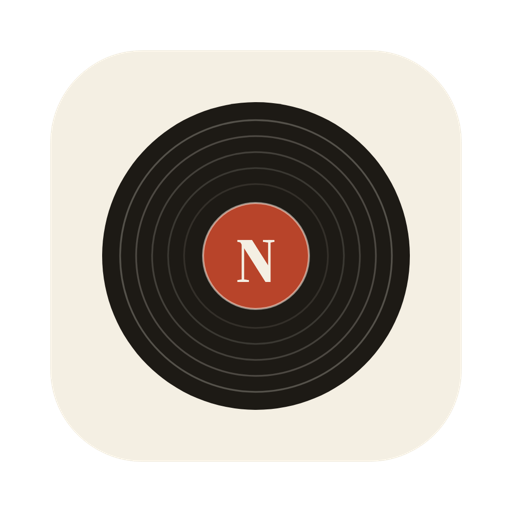
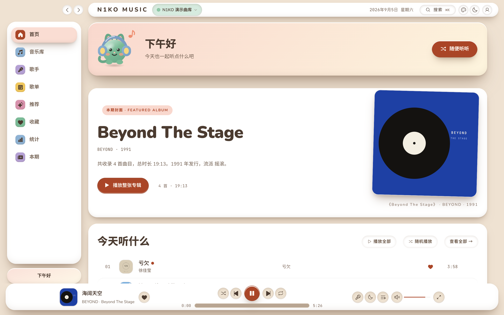
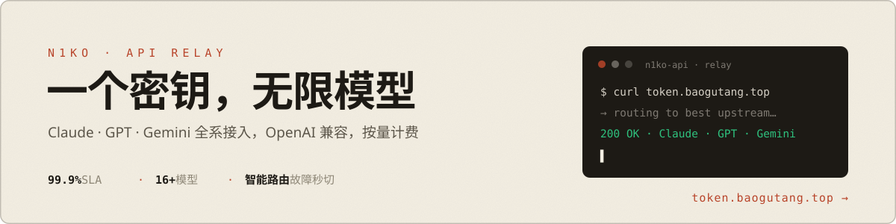
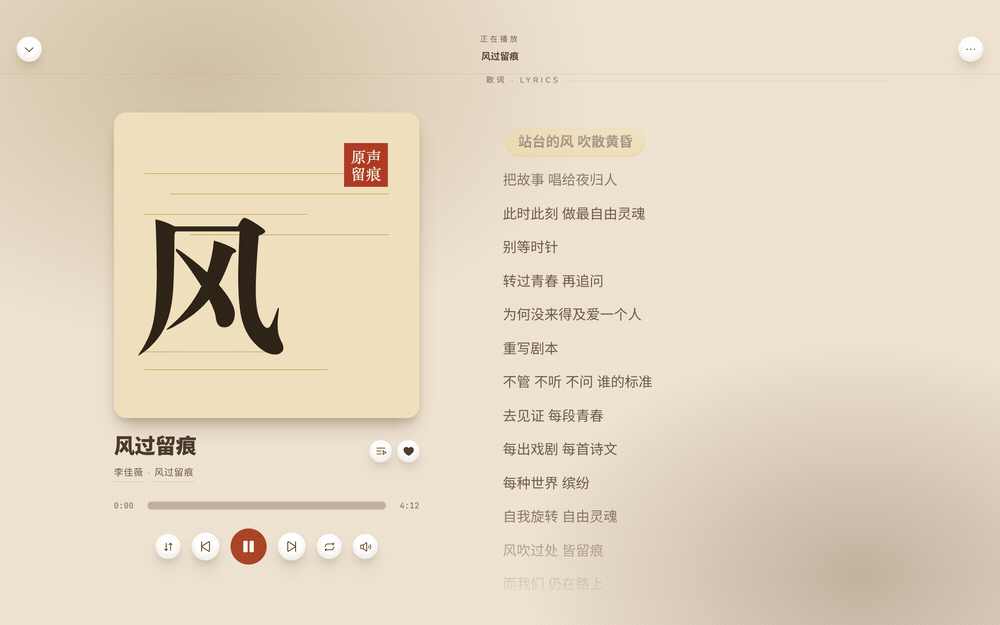
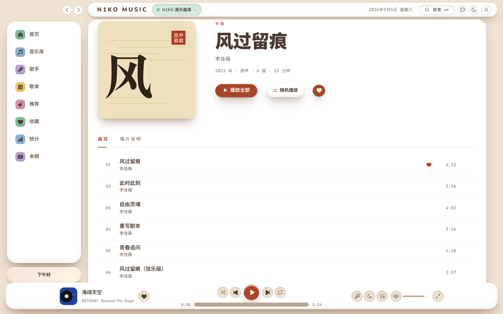
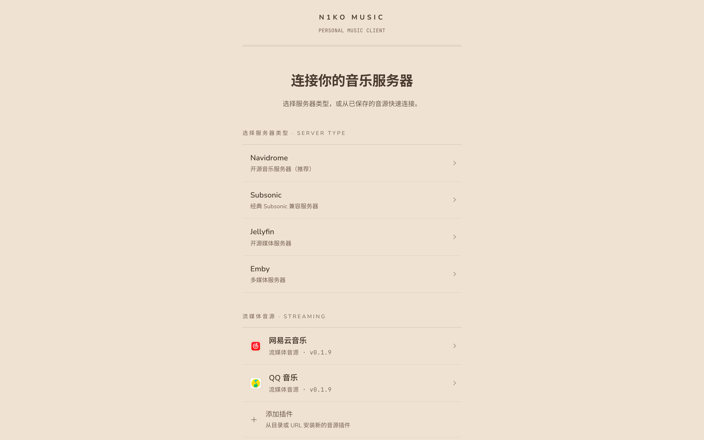
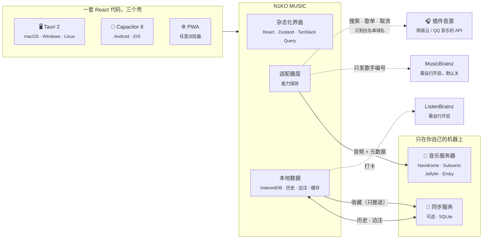

<div align="center">



# N1KO MUSIC

**一本可以播放的音乐杂志**

连上 Navidrome / Subsonic / Jellyfin / Emby，
把自己的曲库读成一本排好版的刊物。
没有 NAS？用自己的网易云音乐 / QQ 音乐账号（QQ 或微信扫码）登录，一样能听。

[](https://github.com/baogutang/N1KO-MUSIC/releases/latest)
[](https://github.com/baogutang/N1KO-MUSIC/stargazers)
[](LICENSE)
[](https://github.com/baogutang/N1KO-MUSIC/releases/latest)

**[🌐 官网](https://baogutang.github.io/N1KO-MUSIC/)** ·
**[⬇ 下载](https://github.com/baogutang/N1KO-MUSIC/releases/latest)** ·
**[English](README.md)** ·
**[参与翻译](TRANSLATING.md)**

<br/>



</div>

<br/>

## 同作者出品 · N1KO-API

[](https://token.baogutang.top)

> 如果你也在用 AI 做东西，这个可能用得上：**[N1KO-API](https://token.baogutang.top)** —— 订阅转 API 中转平台。
> 一个 key 打通 Claude / GPT / Gemini 旗舰模型，智能路由秒级切换，99.9% SLA，按量计费不玩虚的。技术支持 QQ：783246411。

<br/>

## 为什么是杂志

大多数音乐客户端是加了封面图的后台管理系统，按「服务器里有什么」组织：
表格、筛选器、计数。

而一本杂志按「这一期什么值得你看」组织：报头、刊号、封面故事、书眉、版记。
它有语气。N1KO MUSIC 是照这个思路做到底的：

|  | |
|---|---|
| **结构是一本刊物** | 报头、刊号、封面故事、书眉、版记。换皮换的是语气，不是骨架。 |
| **封面是唯一的颜色** | 专辑封面是版面上唯一的大色块，其余交给皮肤的底色与描边。 |
| **三张皮，一键切换** | **[奶油·软陶](https://baogutang.github.io/N1KO-MUSIC/?skin=clay)**（默认）：奶油底、圆头字、软鼓包投影，吉祥物阿糯住在问候横幅里。**[糖果·波普](https://baogutang.github.io/N1KO-MUSIC/?skin=pop)**：奶油底 + 2px 墨描边 + 硬投影，糖果色全部绑定语义。**[纸·墨·朱](https://baogutang.github.io/N1KO-MUSIC/?skin=editorial)**：暖纸、宋体标题、一种朱色。三张皮共用同一套组件，切换只改 `<html>` 上的一个属性。 |
| **自托管字体** | Source Serif 4 / Hanken Grotesk / JetBrains Mono —— 一切时长、序号、码率一律等宽。 |
| **一个字都不编** | 应用里所有自动生成的句子——编者按、重听说明、口味权重——全部由真实数字拼成。数据撑不起某一句，那一句就不出现。 |

音质没有为此让步：FLAC / WAV / ALAC 原码直通，带宽紧张时有 320 / 192 / 128kbps
三档，ReplayGain 直接用服务器已经算好的增益。

完全免费、完全开源，不需要账号，没有埋点，没有增值项。

<br/>

## 界面

<table>
<tr>
<td width="50%"></td>
<td width="50%"></td>
</tr>
<tr>
<td><b>正在播放</b> —— 大封面、歌词流，当前行被高亮，点任意一行跳转。</td>
<td><b>专辑 · 档案页</b> —— 档案式元数据、曲目表、内页说明，以及一块可以写你自己那句话的页边。</td>
</tr>
<tr>
<td></td>
<td></td>
</tr>
<tr>
<td><b>首页 · 封面页</b> —— 头条专辑、编号排列的最近添加、文字化的歌手索引，以及<b>重听</b>。</td>
<td><b>连接</b> —— Navidrome / Subsonic / Jellyfin / Emby 几秒钟连上；网易云 / QQ 音乐扫个码。</td>
</tr>
</table>

<sub>同一套组件，三张皮——直接在官网上切着看：
**[奶油·软陶](https://baogutang.github.io/N1KO-MUSIC/?skin=clay)** ·
**[糖果·波普](https://baogutang.github.io/N1KO-MUSIC/?skin=pop)** ·
**[纸·墨·朱](https://baogutang.github.io/N1KO-MUSIC/?skin=editorial)**。
更多截图：[糖果·波普首页](docs/screenshots/v4/home-pop.png) ·
[纸·墨·朱首页](docs/screenshots/v4/home-editorial.png)</sub>

<br/>

## 栏目

### ♫ 播放

- **真正的全库随机**——从服务器抽样，而不是把当前加载的那一页重排一遍。
  队列面板显示**真实播放顺序**，走完一轮重新洗牌。
- **无损直通**（FLAC / WAV / ALAC）加 320 / 192 / 128kbps 三档，
  **Wi-Fi 与蜂窝分别设置**并自动切换——人在外面不会再把原始文件从家里的上行拽出来。
- **ReplayGain** 用服务器已经算好的增益，不同年代的母带不再忽大忽小。
- **队列不会突然停**——放完自动接相似曲目，任何歌曲、歌手、曲风都能开一台电台。
- **继续听与跨设备续播**——听到一半的长音轨（现场、讲座、有声书）回到首页，
  带着你离开时的位置，断点取自服务器上早就写着的书签。
- 睡眠定时渐弱而不是硬断 · 缓冲时播放键会轻轻呼吸 · 预加载逼近无缝 ·
  0.5–3 倍速带变调补偿。

### ⌘ 操作

- **每个列表都能多选批量操作**——⌘/Ctrl 点选、Shift 连选、触摸端长按进入。
  播放、插队、加歌单、收藏，一次做完。
- **完整的 Media Session 集成**——**Windows SMTC、macOS Now Playing、Linux
  MPRIS** 和安卓/iOS 锁屏都正常，有能拖动的进度条、1024px 封面，按键还
  **可以自己配**（听歌用切歌，听书用 ±15 秒）。
- **拔耳机立刻暂停**，而不是把声音甩到外放；一分钟内插回来接着放。
- **车载模式**——112–128px 触控目标、滑动切歌、屏幕常亮。
- **`n1ko://` 深链接**、⌘K 命令面板、全局快捷键、全键盘控制、长列表字母轨，
  以及**返回时回到原位**的滚动记忆。

### ☰ 曲库

- 歌曲、专辑、歌手、歌单在一处，**虚拟滚动**，一万首也不卡——
  配**离线元数据缓存**，冷启动先把上次的曲库摆出来。
- **内页说明**（制作人员名录、ISRC、MusicBrainz 版本信息）和
  **规格立牌**（位深、采样率、编码、真实码率）。
- **唱片目录年份轨**——一位歌手的作品读成一条生涯，而不是一片封面墙。
- **把队列存成歌单**，存的是你刚听到的那个顺序。歌单就地编辑，队列拖拽排序。
- 分享、评分、重扫、多音乐库、「还有谁在听」——全部只在服务器**确实支持**
  时才出现。一台关掉了分享的 Navidrome 上，分享入口整个不出现。

### ✎ 你自己的

- **《本期》**——每个月自动成为一期：封面故事、排行、本期之最、第一次听到的人。
  编者按由真实数字拼成，一个字不编。
- **重听**——*去年今日*、*久违*、*只听过一次*。你已经喜欢过、正在悄悄丢掉的那些。
- **边注**——给任何歌曲、专辑、歌手写一句自己的话。它是这里唯一不能被重新
  算出来的数据，因此优先同步、优先备份。
- **可改的口味画像**——推荐打分时真正在用的权重摊开给你看，任何歌手或曲风
  都能永久关掉。这是硬过滤，不是降权。
- **导入既有打卡历史**（ListenBrainz / Last.fm 导出），统计和推荐不必从零开始；
  **一切都能导出**——歌单 M3U8/XSPF、历史 JSON/CSV，全部在浏览器里生成，不上传。

### ⚙ 最花时间的细节

中西文之间的细空格、标点悬挂、带斜杠的等宽数字 · 凭据用取不出来的设备密钥
加密落盘 · 离线时是一条带重试按钮的常驻横幅，不是一闪而过的 toast ·
`aria-pressed` 播放开关、WCAG AA 对比度、尊重 `motion-reduce` ·
每一页都有刊号、书眉和版记。

<br/>

## 支持的服务器

| 服务器 | 状态 | 说明 |
|--------|------|------|
| [Navidrome](https://www.navidrome.org/) | ✅ 推荐 | 体验最好，测试最充分 |
| [Subsonic](http://www.subsonic.org/) | ✅ 支持 | 完整兼容 Subsonic API |
| [Airsonic](https://airsonic.github.io/) / [Airsonic-Advanced](https://github.com/airsonic-advanced/airsonic-advanced) | ✅ 支持 | Subsonic 兼容分支 |
| [Jellyfin](https://jellyfin.org/) | ✅ 支持 | 原生 API 对接 |
| [Emby](https://emby.media/) | ✅ 支持 | 原生 API 对接 |

分享、评分、断点、多音乐库、重扫、电台、正在播放这些可选能力是**探测出来的，
不是假设的**。你的服务器没实现哪一项，那个入口就整个不出现，而不是点了报错。

<details>
<summary>相关搜索</summary>
<sub>Navidrome 客户端 · Navidrome 桌面版 · Subsonic 客户端 · Subsonic 音乐播放器 · Jellyfin 音乐播放器 · Emby 音乐播放器 · NAS 音乐播放器 · 自建音乐播放器 · 私有云音乐 · Airsonic 客户端 · 网易云音乐 第三方客户端 · QQ 音乐 桌面客户端</sub>
</details>

<br/>

## 流媒体音源 · 网易云音乐 / QQ 音乐

没有 NAS，或者 NAS 上没有的歌，用你自己的账号登录就能听——
**你有权听什么，这里就放什么**。会员曲你的账号没权限，它就标成 VIP 并告诉你原因，
不做任何「解析」「破解」。

| 音源 | 登录 | 能做什么 |
|------|------|------|
| 网易云音乐 | 手机 App 扫码 | 搜索、我的歌单、收藏、每日推荐、榜单、歌词、加入 / 移出歌单 |
| QQ 音乐 | 手机 QQ / 微信扫码 | 搜索、我的歌单、雷达推荐、榜单、歌词 |

它们和你的 NAS 是**并列**的，不是二选一：**搜索按来源分组**，也能切到「全部」
按相关度混排；首页的**「今天听什么」**把各个音源的每日推荐交错合成一列；
收藏、歌单按来源分节，队列里可以混着放；登录过期会在顶部提示你重新扫码，
而不是让一半的页面无声地消失。

**怎么做到的。** 每个音源是一个插件（[协议文档](docs/sources/PROTOCOL.md)，
兼容 MusicFree 插件的写法，加了扫码登录等 `n1ko` 扩展），跑在一个只允许执行脚本的
沙箱里：不能碰页面，不能自己联网，只能通过宿主访问 manifest 里白名单列出的域名，
重定向每一跳都重新过白名单。出厂的两个插件随安装包一起打进去，首次启动自动就绪。

**边界，直接说清楚。** 这些接口来自社区的逆向整理，不是官方开放接口——平台一改，
它们可能失效，我们会跟着修，但不保证永远可用。凭据用与服务器密码同一套 AES-GCM
加密只存在本机，不经过任何第三方服务器。流媒体音源只在桌面版与 App 里提供
（浏览器版没有可用的出网通道）。

<br/>

## 下载

在 **[Releases](https://github.com/baogutang/N1KO-MUSIC/releases/latest)** 里挑你的平台：

| 平台 | 安装包 |
|------|--------|
| macOS（Apple 芯片） | `N1KO.MUSIC_x.x.x_aarch64.dmg` |
| macOS（Intel） | `N1KO.MUSIC_x.x.x_x64.dmg` |
| Windows | `N1KO.MUSIC_x.x.x_x64-setup.exe` / `.msi` |
| Linux | `.AppImage` / `.deb` |

**移动端**——由 [Mobile 工作流](https://github.com/baogutang/N1KO-MUSIC/actions/workflows/mobile.yml)
构建，在最近一次运行的 Artifacts 里下载：

| 平台 | 包 | 说明 |
|------|--------|------|
| Android | `N1KO-MUSIC-android-debug` → `app-debug.apk` | Debug 包，可直接安装（需允许未知来源） |
| iOS | `N1KO-MUSIC-ios-unsigned` → `.zip` | 未签名，用 AltStore / Sideloadly 侧载 |

> 正式签名的移动端构建（Play keystore / Apple 开发者证书）还没配，工作流留好了位置，
> 补上时不需要改结构。macOS 首次打开若提示「无法验证开发者」，到
> 「系统设置 → 隐私与安全性」里允许即可；若提示**「“N1KO MUSIC”已损坏，无法打开」**，
> 在终端执行一次下面这行再打开：
>
> ```bash
> xattr -cr "/Applications/N1KO MUSIC.app"
> ```
>
> （安装包目前是 ad-hoc 签名；Developer ID 公证版在计划里。）

<br/>

## 开发

```bash
git clone https://github.com/baogutang/N1KO-MUSIC.git
cd N1KO-MUSIC/frontend
npm install
npm run dev          # Web 开发模式
npm run tauri:dev    # 桌面开发模式
```

不需要自己有服务器：把地址填成 `https://demo.navidrome.org`，用户名密码都是 `demo`。

同一套 React 前端也跑在 Capacitor 壳里，带原生后台播放与锁屏控制：

```bash
cd frontend
npm run cap:sync            # 构建 Web 产物并同步到原生工程
npx cap open android        # 需要 Android Studio / SDK
npx cap open ios            # 需要 Xcode + CocoaPods
```

<details>
<summary><b>它是怎么搭起来的</b> —— 架构图</summary>

<br/>



**只在你自己的机器上**框里的一切都是你的。虚线是可能离开你网络的路径：
ListenBrainz 与 MusicBrainz 都要你自己开（MusicBrainz 默认关闭）；插件音源
只在登录网易云 / QQ 音乐后出现，且沙箱只能访问各自 manifest 白名单里的域名。

</details>

<details>
<summary><b>可选同步服务</b> —— 跨设备的历史、收藏（推送）与边注</summary>

<br/>

`backend/` 提供账号、歌单、收藏、收听历史与边注接口（歌单与收藏增量拉取暂未接入客户端）。它**完全可选**：
音乐永远直接从你自己的音乐服务器流出，不配同步服务时功能一样完整，
数据全部存在本机 IndexedDB 里。

部署好之后打开 **设置 › 跨设备同步（SYNC）**，填地址登录即可。
客户端会双向同步听歌历史、把收藏的变更推送到同步服务（新设备上恢复
收藏依赖音乐服务器本身），并双向合并边注——
换一台机器时推荐不必从零学起。

```bash
cd backend
npm ci
npm test
JWT_SECRET="换成一串足够长的随机值" DATA_DIR=./data npm start
```

Docker 部署必须挂载 `/app/data`，否则重建容器会同时丢掉数据库和自动生成的 JWT 密钥：

```bash
docker build -t n1ko-music-backend backend
docker run -d --name n1ko-music-backend \
  -p 3001:3001 \
  -v n1ko-music-data:/app/data \
  -e JWT_SECRET="换成一串足够长的随机值" \
  n1ko-music-backend
```

支持的环境变量：`PORT`、`DATA_DIR`、`JWT_SECRET`、逗号分隔的 `FRONTEND_URLS`、
`TRUST_PROXY_HOPS`、`RATE_LIMIT_MAX`、`AUTH_RATE_LIMIT_MAX`、`ALLOW_REGISTRATION`、
`LOGIN_ATTEMPT_MAX`、`LOGIN_ATTEMPT_WINDOW_MS`。

> **跑在反向代理（Nginx / Caddy / traefik）后面？必须设置 `TRUST_PROXY_HOPS`**
> （通常为 `1`）。不设的话，限流与登录锁会按代理地址记账——所有用户共用一个桶。

任何迁移执行前都会在数据目录里做一份一致性备份；并且有一个测试专门断言
「从老版本升级上来的库」与「今天全新建的库」逐列、逐索引、逐约束完全一致。

> **注册策略（v1.7.0 起变更）**：`ALLOW_REGISTRATION` 默认 `first-user`——
> 第一个账号建立之前开放，之后自动关闭。同步服务一旦暴露到公网，这条就很要紧。
> **已有部署要给家人加账号时，请临时改成 `open`**，或者用 `closed` 彻底锁死。
>
> **JWT 密钥**：不设 `JWT_SECRET` 时服务会自己生成 48 字节随机密钥并以 0600 落盘，
> 比手写一个更安全。如果要自己设，至少 32 个字符，否则服务拒绝启动。

</details>

<details>
<summary><b>Docker 版 Web 客户端</b> —— 不想装应用的话</summary>

<br/>

```bash
docker build -t n1ko-music-web frontend
docker run -d --name n1ko-music-web -p 8080:80 \
  -e DEFAULT_SERVER_URL=https://music.example.com \
  -e DEFAULT_SERVER_TYPE=navidrome \
  n1ko-music-web
```

</details>

<br/>

## 技术栈

| 层 | 技术 |
|------|-----|
| 前端 | React 18 · TypeScript · Vite 5 · Tailwind CSS |
| UI | Radix UI · Phosphor Icons · 自托管字体（Source Serif 4 / Hanken Grotesk / JetBrains Mono / Nunito） |
| 状态与数据 | Zustand · TanStack Query v5 |
| 音频引擎 | 原生 HTML5 Audio |
| 流媒体音源 | 沙箱化插件（MusicFree 兼容协议 + `n1ko` 扩展），宿主按白名单代理出网 |
| 桌面壳 | Tauri 2（Rust） |
| 移动壳 | Capacitor 8（Android · iOS） |
| 可选同步服务 | Node.js 24 · Express · SQLite |
| 多语言 | 扁平 JSON 词条，零运行时依赖（[来贡献一种语言](TRANSLATING.md)） |

<br/>

## 隐私，直接说清楚

| 什么 | 去了哪 |
|---|---|
| 你的音乐 | 你的音乐服务器（NAS），以及你登录过的插件音源。没有别处。 |
| 收听历史、统计、口味画像 | 这台设备（IndexedDB），以及你自己跑的同步服务（如果有）。 |
| 边注 | 同上。它是这里唯一无法重建的数据，所以优先同步。 |
| 服务器凭据 | 用页面脚本取不出来的 AES-GCM 密钥加密落盘。 |
| 网易云 / QQ 音乐的登录凭据 | 同上。只在本机；插件在沙箱里跑，出网只能到 manifest 白名单里的域名。 |
| 导出的文件 | 在浏览器里生成，不上传。 |
| ListenBrainz 打卡 | 只有你填了 token 才发，默认关闭。 |
| MusicBrainz 歌手档案 | 只发歌手的 MusicBrainz 编号，且只有你打开开关才发，默认关闭。 |
| 埋点、统计、崩溃上报 | 没有。也没有可以发过去的服务器。 |

<br/>

## 参与

欢迎 PR。动手前请先读 **[CONTRIBUTING.md](CONTRIBUTING.md)**，尤其是设计契约那一节。
这个项目的视觉是有立场的（只有一种强调色、不叠卡片、只用 Phosphor 图标），
颜色一律取自 `frontend/src/index.css` 里的 token。

翻译完全不需要懂 React —— 见 **[TRANSLATING.md](TRANSLATING.md)**。

<br/>

## 致谢

N1KO MUSIC 站在这些优秀项目的肩膀上：

- [StreamMusic](https://github.com/gitbobobo/StreamMusic) —— 设计极其出色的 Flutter NAS 音乐播放器，本项目的 UI 与交互深受其启发
- [Navidrome](https://www.navidrome.org/) —— 出色的开源 Subsonic 服务端
- [MusicBrainz](https://musicbrainz.org/) · [ListenBrainz](https://listenbrainz.org/) —— 开放的音乐数据，不附加任何条件
- [Radix UI](https://www.radix-ui.com/) · [TanStack Query](https://tanstack.com/query) · [Zustand](https://github.com/pmndrs/zustand)

<br/>

## Star 趋势

<a href="https://star-history.com/#baogutang/N1KO-MUSIC&Date">
 <picture>
   <source media="(prefers-color-scheme: dark)" srcset="https://api.star-history.com/svg?repos=baogutang/N1KO-MUSIC&type=Date&theme=dark" />
   <source media="(prefers-color-scheme: light)" srcset="https://api.star-history.com/svg?repos=baogutang/N1KO-MUSIC&type=Date" />
   
 </picture>
</a>

<br/>
<br/>

<div align="center">

<sub>N1KO MUSIC &nbsp;·&nbsp; 由 [N1KO](https://github.com/baogutang) 打造 &nbsp;·&nbsp; 也欢迎看看 **[N1KO-API](https://token.baogutang.top)**</sub>

如果 N1KO MUSIC 对你有用，一颗 ⭐ 对我意义重大。

</div>
